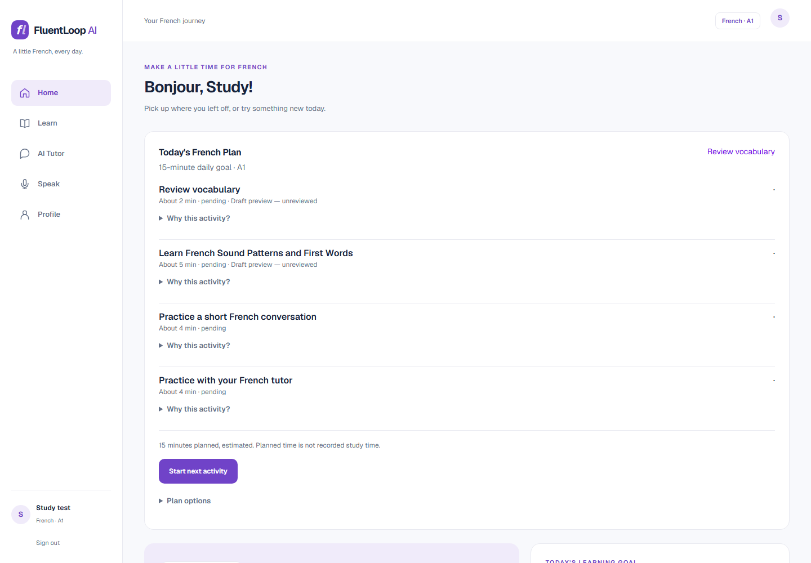

# FluentLoop AI

A local-first French learning application built with Next.js and FastAPI. Milestones 01–07 provide secure accounts, curriculum-based lessons, a local AI tutor, voice conversations, daily learning plans and spaced repetition. No Milestone 08 features are included.



## Features

- Email-verified registration, optional age with only a broad age band retained, Argon2id password hashing, server-side sessions, CSRF protection and Redis rate limiting.
- Profile personalization and CEFR levels A1, A2, B1, B2, C1 and C2; changing level preserves earlier progress.
- Versioned curriculum imports, published-content access controls, resumable lessons and backend grading.
- Ollama text tutoring with authorized curriculum retrieval, sentence correction, roleplay and private conversation history.
- Microphone recording and playback, local French transcription and text-to-speech, editable uncertain transcripts and explicit confirmation. Original recognition and learner corrections remain separate in history.
- Persisted daily plans, deterministic activity selection and versioned SM-2-inspired vocabulary review. Planning and grading work without an AI model.
- Responsive white-and-purple interface with keyboard-accessible navigation.

## Current limitations

**Ten A1 lessons remain unpublished drafts awaiting independent French and licensing review.** Ordinary learners cannot access them. A separately gated development preview is available to authorized administrators. Supporting six CEFR preferences does not imply complete curriculum coverage at all six levels.

The corrected A1 draft is version **1.0.2**. See [correction results](docs/content/reviews/A1_CONTENT_CORRECTION_RESULTS.md), [independent review checklist](docs/content/reviews/A1_INDEPENDENT_REVIEW_CHECKLIST.md) and [publication readiness](docs/verification/A1_CURRICULUM_PUBLICATION_READINESS.md). Technical validation does not authorize publication.

**Acoustic pronunciation scoring has not been validated and is unavailable.** Speech recognition can mishear names and short introductions, even with the Base model. Transcripts require learner review; ASR output is not a pronunciation score. Local model latency and accuracy depend on hardware. AI-generated teaching responses can contain errors.

This is a development deployment, not a claim of production operational readiness. Billing and subscriptions are not implemented.

## Architecture and technologies

```text
Browser: Next.js 16 / React 19 / TypeScript / Tailwind CSS
    | session cookies + CSRF
FastAPI / Pydantic / SQLAlchemy 2 / Alembic
    |-- PostgreSQL 16: accounts, curriculum, progress, conversations, review history
    |-- Redis 7: rate limiting
    |-- Mailpit: development email
    |-- Ollama: optional local text model
    `-- private speech worker: Faster-Whisper + Piper, local model files
```

The backend obtains identity from the authenticated session. Tutor requests receive only the necessary first-name hint, never account passwords, session tokens or email addresses. Content authorization and user isolation apply to lesson, AI, speech and review APIs. Speech workers have no public port and use separate worker credentials. Raw learner audio retention is optional and off by default.

```text
backend/app/          API, models, learning services, AI and speech providers
backend/alembic/      Eight ordered database migrations
backend/content/a1/   Versioned draft curriculum source
backend/tests/        Functional, security and opt-in PostgreSQL tests
backend/scripts/      Guarded isolated integration-test servers
frontend/app/         App Router pages
frontend/components/  Shared interface and session components
frontend/e2e/         Playwright browser tests
scripts/              Safe environment setup
.github/workflows/    Isolated CI jobs
docs/                 Architecture, content, security and verification guides
```

## Quick start with Docker

Install Docker Desktop with Linux containers, Python 3.12 and Git. Node.js 20+ is needed for native frontend checks.

```powershell
git clone https://github.com/Shyamsundar0606/FluentLoop-AI.git
Set-Location FluentLoop-AI
python scripts/create_local_env.py
docker compose config --quiet
docker compose up --build -d
docker compose ps
```

The helper creates a private `.env` with independent cryptographically random database passwords and speech-worker keys. It refuses to overwrite an existing environment. `.env.example` deliberately contains nonfunctional placeholders; copying it alone is insufficient. Keep `.env` private. Existing installations must retain their own configuration and volumes; generating a new environment does not rotate an existing database password.

| Service | Local URL |
| --- | --- |
| Application | http://localhost:3000 |
| API documentation | http://localhost:8000/docs |
| API readiness | http://localhost:8000/api/v1/health/ready |
| Development inbox | http://localhost:8025 |

Registration verification and password-reset mail goes to Mailpit. Database and cache ports bind to loopback. Backend startup runs Alembic migrations; do not replace migrations with `create_all` or recreate an existing database. **Never use `docker compose down -v` against an installation whose data you want to keep.**

Create an administrator interactively if needed:

```powershell
docker compose exec backend python -m app.cli create-admin admin@example.com
```

Use a dedicated email you control. For internet deployment, configure TLS, secure cookies, explicit allowed origins, a real SMTP service, backups and independent operational/security review.

## Curriculum and draft preview

Content import does not publish lessons:

```powershell
docker compose exec backend python -m app.content_import --validate-only
docker compose exec backend python -m app.content_import --dry-run
docker compose exec backend python -m app.content_import --apply
docker compose exec backend python -m app.content_report
```

Publication requires independent review evidence through the administrative publication workflow. Do not publish the draft A1 lessons merely to make a learner screen show content.

The optional preview stack has separate database, Redis, email, audio and session settings:

```powershell
docker compose -p fluentloop-preview -f docker-compose.preview.yml up --build -d
```

Preview UI/API/inbox use ports 3001/8001/8026. Its startup imports draft content and retains the existing administrator-only preview gate. See the [content authoring guide](docs/content/content-authoring-guide.md) and [import guide](docs/content/content-import-guide.md).

## Ollama

Ollama is optional; unavailable models return controlled errors while ordinary learning features remain available. Choose a model suitable for available RAM/VRAM. Provision it explicitly:

```powershell
docker compose --profile ai up -d ollama
docker compose exec ollama ollama pull llama3.2:3b
# Set OLLAMA_MODEL=llama3.2:3b in the private .env
docker compose up -d --no-deps backend
```

For an existing host Ollama installation, set `OLLAMA_BASE_URL=http://host.docker.internal:11434` in Docker Desktop. No model is downloaded automatically at request time. See [Ollama setup](docs/ai/ollama-setup.md).

## French speech models

Speech is optional and runs locally in a separate worker. Model weights, generated speech and private recordings are excluded from Git. Explicit provisioning records model revisions and hashes:

```powershell
python -m venv .venv-speech
.\.venv-speech\Scripts\python.exe -m pip install -r backend/requirements-speech.txt
$env:PYTHONPATH = 'backend'
.\.venv-speech\Scripts\python.exe -m app.speech.provision_models --destination .speech-models --download-compact-models --asr-model base
# Set SPEECH_ASR_MODEL=base in .env only after provisioning succeeds
docker compose --profile speech up --build -d
```

Tiny is the compatible default; Base is the measured local refinement and still makes spelling/name errors. CPU int8 is the verified path; no GPU accuracy/performance claim is made. French TTS uses `fr_FR-siwis-medium`. Review model/voice licenses and attribution before redistribution. See [Faster-Whisper setup](docs/speech/faster-whisper-setup.md), [French TTS](docs/speech/french-tts-setup.md), [assessment limitations](docs/speech/pronunciation-assessment.md) and [speech privacy](docs/security/speech-data-privacy.md).

## Development and testing

Core backend tests use isolated fixtures. Native development needs a private `DATABASE_URL` with a loopback host, plus loopback Redis/SMTP addresses instead of Compose service hostnames. Supply these through your shell or private environment; do not paste credentials into source files or command history.

```powershell
python -m venv .venv312
.\.venv312\Scripts\python.exe -m pip install -r backend/requirements.txt
Push-Location backend
..\.venv312\Scripts\python.exe -m pytest tests -ra
Pop-Location
Push-Location frontend
npm ci
npm run lint
npm run typecheck
npm run build
npx playwright install chromium
npm run test:e2e
Pop-Location
```

PostgreSQL tests are opt-in: use `AI_TEST_DATABASE_URL` with a dedicated `fluentloop_m05_*` database, `SPEECH_TEST_DATABASE_URL` with `fluentloop_m06_*`, and `STUDY_TEST_ADMIN_DATABASE_URL` on localhost with permission to create fresh `fluentloop_m07_*` databases. Migrate test databases before use. Never point integration tests at learner databases. Live Ollama/speech and prepared real-API Playwright scenarios need their documented explicit flags and isolated services; ordinary CI does not claim live-model inference.

Playwright defaults to frontend port 3001 and API port 8001. Its default mocked scenarios and opt-in real API scenarios have different setup requirements. Use a dedicated test stack, including separate rate-limit state. See [M07 verification](docs/verification/MILESTONE_07_VERIFICATION.md), [voice refinement](docs/verification/VOICE_CONVERSATION_REFINEMENT.md) and [publication verification](docs/verification/GITHUB_PUBLICATION.md). Raw local test reports and recordings are intentionally not distributed.

CI generates independent random credentials on each disposable GitHub runner; it never uses local deployment credentials. It runs core backend tests, frontend lint/typecheck/build and default browser checks. Live-model and prepared PostgreSQL/browser checks remain explicitly opt-in.

## Security and repository hygiene

Private environments, database volumes/dumps, local test data, private recordings, generated audio, model weights/caches, logs and raw verification artifacts are ignored. Public speech test fixtures retain their [upstream attribution](backend/tests/fixtures/speech/ATTRIBUTION.md). The README screenshot uses only a synthetic test account.

The original frontend starter commit is retained as the publication commit's ancestor, with source organized under `frontend/` and `backend/`. Security remediation changes configuration and publication tooling, not learning features. For architecture details, see [adaptive learning](docs/architecture/adaptive-learning-engine.md), [daily planning](docs/learning/daily-study-plan.md), [spaced repetition](docs/learning/spaced-repetition.md) and [security](docs/security/adaptive-learning-security.md).
