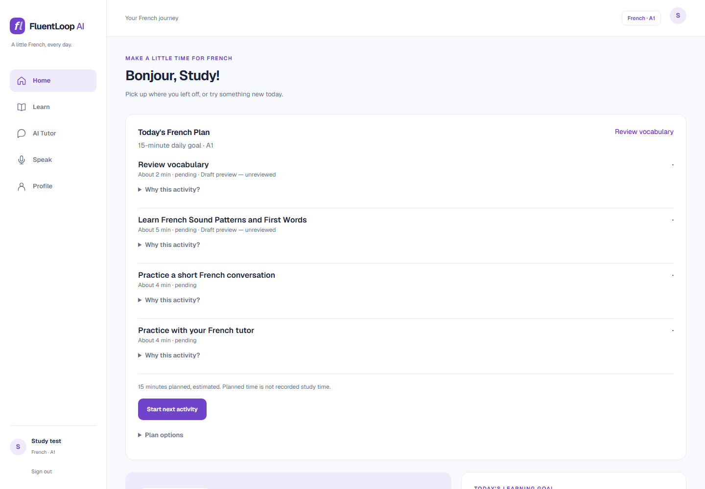

# FluentLoop AI

**A personal French-learning project built to make regular practice easier.**

FluentLoop AI brings lessons, vocabulary revision, an AI tutor and speaking practice into one local application. It is designed for a learning journey from first French words to more demanding C2-targeted activities, with saved history so you can return and continue practising.

This is a student project for **personal local use**. It is not a public learning service or an official language qualification.



## What can I do with it?

- **Learn step by step:** follow a path through sounds, everyday French, grammar and more advanced communication.
- **Practise vocabulary:** review words and expressions using spaced repetition.
- **Try different exercises:** answer questions, complete sentences, match items and practise reading and listening.
- **Talk to the AI Tutor:** ask for explanations, practise realistic situations and get feedback using a local Ollama model.
- **Practise speaking:** record French, review the transcription and listen to the tutor's French audio.
- **Write and revise:** save your writing, request advisory feedback and keep revisions separately from the original.
- **Continue later:** resume supported lesson sessions, revisit mistakes and view saved learning, assessment and conversation history.

AI feedback can make mistakes. Speech transcription also needs your review and does not measure pronunciation accuracy.

## The learning path

The current personal installation has **52 modules, 317 unpublished lessons, 892 scored exercises and 118 open writing/transfer task lessons**.

| Stage | Focus | Available lessons |
|---|---|---:|
| A0 preparation | First sounds, words and polite exchanges | 12 |
| A1 | Familiar routines and simple everyday communication | 63 |
| A2 | Practical situations, plans and past experiences | 50 |
| B1 | Connected explanations, experiences and opinions | 50 |
| B2 | Arguments, detailed comprehension and register | 50 |
| C1 | Complex sources, formal communication and nuance | 46 |
| C2 | Demanding interpretation and precise expression | 46 |

A0 is an introductory stage, not an official CEFR level. These counts describe the current personal database; cloning the repository does not create or copy that database.

Open **Learning path** (`/learning-path`) to browse the stages. Open **Module and level check plans** (`/checkpoints`) for 52 module plans and seven sampled level-end review plans. These reuse practice material and do not award a CEFR certificate or automatically promote your account level.

**The curriculum is still draft material.** Every module has authored input, but that does not establish complete CEFR coverage or independent teacher approval. Qualified French review, broader listening materials, productive-skill ratings and assessment calibration remain work in progress. Five additional unscored writing bridges are staged and have not been imported into the personal database.

The [A1–C2 roadmap practice batch](docs/learning/ROADMAP-PRACTICE-UPDATE.md)
is now included as unpublished personal drafts: 68 topics, 136 lessons, 272 scored
exercises and 68 writing/speaking tasks. It passed exact-batch disposable database,
answer-key, synthesis and automated playback checks before the authorized import.
Qualified human review, physical acceptance of the new audio and empirical CEFR
calibration remain pending. Lesson counts do not establish full CEFR competence.

See the [competency audit](docs/learning/COMPETENCY-AUDIT.md) for the remaining gaps and the [verification report](docs/verification/PERSONAL_LOCAL_COMPLETION.md) for the evidence behind the current status.

## Run the existing personal installation

These steps are for the **already configured Windows installation**. A fresh clone needs private configuration, existing service identities, model files and an appropriate database first. Follow the [personal-operation guide](docs/learning/personal-local-operation.md) for setup; do not point an unconfigured launcher at a database containing learning history.

The launcher checks configuration, service ownership and storage before starting. The current minimum reserve is **30 GiB free on C:** and **50 GiB free on D:**. These checks reduce risk; they do not guarantee storage health.

In Windows PowerShell:

```powershell
cd "D:\shyam\Projects\FluentLoop AI"

# Check the local configuration without starting services.
.\scripts\start_personal_local.ps1 -CheckOnly

# Start after the documented recovery and maintenance checks are satisfied.
.\scripts\start_personal_local.ps1 -ApproveProtectedServices -RecoveryPrerequisitesSatisfied
```

Keep the startup console open while studying. If a check fails, resolve the reported problem rather than bypassing the guard.

| Page | Local address |
|---|---|
| Sign in | [127.0.0.1:3000/login](http://127.0.0.1:3000/login) |
| Learning path | [127.0.0.1:3000/learning-path](http://127.0.0.1:3000/learning-path) |
| Review plans | [127.0.0.1:3000/checkpoints](http://127.0.0.1:3000/checkpoints) |
| Local verification/reset inbox | [127.0.0.1:8025](http://127.0.0.1:8025) |
| API documentation | [127.0.0.1:8000/docs](http://127.0.0.1:8000/docs) |

Use your existing account. If you forget the password, choose **Forgot password** and follow the email in the local Mailpit inbox. Enter the new password privately.

To finish, open another PowerShell console:

```powershell
cd "D:\shyam\Projects\FluentLoop AI"
.\scripts\stop_personal_local.ps1
```

The shutdown script stops services owned by that launcher run and preserves their persistent data. Normal personal startup does not import lessons or run database migrations. Draft access is limited to the confirmed learner through private configuration; it does not grant administrator or publisher rights.

## A simple study routine

1. Choose a stage and read the lesson's explanation and examples.
2. Complete the exercises and read the feedback on mistakes.
3. Reuse the language in a short written message or spoken exchange.
4. Review saved mistakes and vocabulary on another day.
5. Return to your history to see what you have actually practised.

Use the AI Tutor for extra practice and clarification. Treat its responses as helpful suggestions to check, especially for difficult grammar or nuanced French.

## How the project works

| Technology | Its role in the project |
|---|---|
| Next.js, React, TypeScript and Tailwind CSS | Pages, navigation and the learning interface |
| FastAPI and Python | Login, learning activities, grading and service APIs |
| PostgreSQL and Alembic | Saved accounts, lessons, history and versioned database changes |
| Redis | Request rate limits and supporting runtime state |
| Ollama | Local AI tutoring |
| Faster-Whisper and Piper | Local speech recognition and French text-to-speech |
| Docker Desktop | Existing PostgreSQL, Redis and Mailpit infrastructure |
| Pytest, Playwright and GitHub Actions | Automated checks |

The personal launcher keeps services on localhost. AI and speech use separately installed local models; the launcher does not automatically download them. Text learning does not require model inference, although AI and speech features need their services to be available.

## Find your way around the code

```text
backend/app/          Python APIs, learning services and AI/speech integration
backend/alembic/      Database migrations
backend/content/      Versioned curriculum drafts and the learning-path map
backend/scripts/      Curriculum authoring and validation tools
backend/tests/        Backend, security and database tests
frontend/app/         Application pages
frontend/components/  Shared interface components
frontend/e2e/         Browser tests
scripts/              Personal startup/shutdown and test helpers
docs/                 Learning, setup, architecture and verification guides
.github/workflows/    GitHub Actions checks
```

## Development and testing

Use a separate development/test environment. Do not run imports, migrations or destructive tests against a database containing personal learning records.

Frontend dependencies are also needed by the backend's real Next.js launcher test. In a development checkout, install the pinned packages first:

```powershell
cd frontend
npm ci
npm run lint
npm run typecheck
npm run build
cd ..

# Use the existing Python environment with backend requirements installed.
cd backend
..\.venv312\Scripts\python.exe -m pytest tests -ra
cd ..
```

Browser tests use a separate frontend/API setup, normally on ports 3001/8001. Run them after preparing the isolated test environment described in the [verification report](docs/verification/PERSONAL_LOCAL_COMPLETION.md) and [admin browser guide](docs/verification/ADMIN-BROWSER-HARNESS.md). Real PostgreSQL, AI and speech tests need their documented opt-in settings and disposable data. A standard CI pass does not prove live model or physical microphone performance.

## What is kept private?

GitHub contains the application code, curriculum source, tests and public documentation. It intentionally does **not** contain private `.env` files, personal database contents, backups, recordings, downloaded model weights, virtual environments, `node_modules` or generated build/test files. Those files stay local and are not missing source code.

Keep backups and private settings safe. Never reset or remove database volumes to fix an ordinary startup problem. Importing a curriculum draft does not publish it; publication requires a separate review and decision.

## More detailed guides

- [Personal setup, startup and shutdown](docs/learning/personal-local-operation.md)
- [Current verification and known limitations](docs/verification/PERSONAL_LOCAL_COMPLETION.md)
- [Curriculum coverage and remaining gaps](docs/learning/COMPETENCY-AUDIT.md)
- [Assessment and progression](docs/learning/ASSESSMENT-AND-PROGRESSION.md)
- [Content authoring](docs/content/content-authoring-guide.md) and [safe imports](docs/content/content-import-guide.md)
- [Local Ollama setup](docs/ai/ollama-setup.md)
- [Speech recognition](docs/speech/faster-whisper-setup.md) and [French audio](docs/speech/french-tts-setup.md)
- [Speech privacy](docs/security/speech-data-privacy.md) and [pronunciation limitations](docs/speech/pronunciation-assessment.md)

Older milestone and Docker preview guides remain in `docs/` for reference. They describe separate historical environments and are not the daily personal startup procedure.

## About the developer

**Shyamsundar Sasikumar**

MSc in Computer Security, EPITA, Paris, France

Email: [shyamsundar.sasikumar@gmail.com](mailto:shyamsundar.sasikumar@gmail.com)
