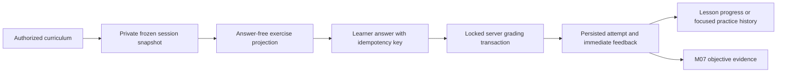

# Interactive learning engine (Milestone 08)

M08 extends the persisted M04 learning engine. It does not introduce another
progress system, speech pipeline, grading service or spaced repetition scheduler.
The learning sequence is **Understand → Practice → Speak → Remember**.

## Persistence

Existing `learning_sessions`, `learning_session_exercises`, `exercise_attempts`,
`lesson_progress` and activity events remain authoritative. Full sessions use
`activity_key=lesson`. Focused sessions use a server-built `practice:` key.
The active-session unique index includes that key, allowing a focused activity
and a full lesson to coexist. Practice completion never increments full lesson
completion counts or creates a `LessonProgress` row.

The server freezes validated exercise definitions, option IDs, shuffled tile
order and independently shuffled matching sides when starting a session.
Resume uses that snapshot, including its original answer key. Changing a source
definition cannot change the grade of an existing session. Live source access
is still required: historical snapshots are not a permission bypass.

Old multiple-choice attempts retain their option UUID in `submitted_answer`.
Structured answers use nullable `answer_payload` JSONB; their legacy string
column contains a bounded reference, not truncated learner text. Normalized
answers and server feedback remain in existing attempt columns. Existing rows,
IDs, timestamps and saved snapshots are not rewritten.

Submission locks the owned session and exercise, then enforces ordered answering
and existing unique constraints. Identical retries replay the saved grade;
different payloads cannot reuse a key or overwrite a prior answer. Completion
is server-side and requires an attempt for every saved exercise.

## Schema

`20261104_0009_interactive_practice.py` follows verified head
`20261104_0008`. Additions are:

- `exercises.exercise_data`, nullable objective/topic foreign keys, and the
  `listening` exercise type.
- `grammar_topics.publication_status` (legacy default `inherited`) and
  `teaching_metadata`.
- `exercise_attempts.answer_payload` and `learning_sessions.activity_key`.
- An extended existing active-session index; no parallel progress tables.

Revision 0003 creates curriculum tables from live ORM metadata during fresh
installation. Revision 0009 inspects its own additions and normalizes their
foreign keys/check constraints, handling both that fresh path and genuine
pre-M08 upgrades without editing old migrations. Downgrade refuses to discard
structured answers, practice sessions, enriched grammar or objective mappings.

Only isolated M08/test databases were migrated in this task. Existing main and
preview databases remain at 0008. Do not run a generic upgrade against those
databases as part of the local demo.

## API additions

All paths below are under `/api/v1`; authentication is mandatory and mutations
retain CSRF checks.

| Endpoint | Purpose |
| --- | --- |
| `GET /learning/library?level=A1` | Authorized lessons, real objectives, units, progress and saved full-session links |
| `GET /learning/grammar?level=A1` | Authorized explanations, examples, translations, teaching notes and objective references |
| `GET /learning/practice/catalog?level=A1` | Actual available exercise counts by category |
| `GET /learning/mistakes?level=A1&lesson_id=…` | Current authorized unresolved attempts with genuine objective mappings |
| `GET /learning/sessions/{id}/review` | Owned historical mistakes and current focused-practice availability |
| `POST /learning/sessions/{id}/position` | Persist reading position 0–3 in an owned active guided full session |
| `POST /learning/practice/sessions` | Start/resume a focused subset in the existing engine |
| `POST /learning/sessions/{id}/answers` | Existing route extended with mutually exclusive typed, tile and matching payloads |
| `POST /learning/sessions/{id}/exercises/{exercise_id}/audio` | Owned, permission-checked Piper listening audio |
| `POST /learning/lessons/{id}/tutor` | Existing owned, lesson-linked tutor conversation |
| `POST /learning/lessons/{id}/speaking` | Existing owned speech session linked to an authorized AI conversation |

CEFR values remain exactly A1, A2, B1, B2, C1, C2. Conversation actions require
the lesson to match the learner's saved level; browsing does not silently change
that preference. Existing API fields remain available; additions are additive.

## Frontend

The five primary destinations are unchanged. `LearningTabs` supplies Lessons,
Grammar and Practice inside Learn, replacing the redundant section navigation
on those three pages. Existing course/detail routes remain available.
`LessonLibrary`, `GrammarDetails`, `LessonActions` and `ExerciseInput` reuse the
existing protected pages, API client, lesson session and results pages.

M08.2 marks newly created full lesson snapshots with `learning_flow_version: 1`.
Their existing section-position column stores Introduction, Explanation,
Examples or Exercises; legacy snapshots retain direct exercises and are never
rewritten. Focused practice also opens exercises directly. Submitted raw answers
are rendered from saved attempts in feedback/results. Retry retains the exact
payload and idempotency key; after an ambiguous save, edits stay disabled until
retry or an authoritative server reload. URL context carries the selected level
and returning lesson without changing the learner's saved preference.

ExerciseInput renders radio choices, typed answers, accessible word buttons,
matching selects and native audio controls. Sentence tiles support remove,
undo and reset. The session owns the answer and retry key so a recoverable
save/refresh failure retains the submitted payload. Scores and feedback are
always returned by the server.

## M05–M07 integration

Tutor and speaking actions create existing conversation types with a bounded
authorized lesson ID. Retrieval never reads exercise definitions, answer keys
or attempt snapshots. Existing profile minimization, first-name hint, fallback,
history and voice transcript review remain intact. Core grading works without
Ollama or speech inference.

New attempts can carry an explicit objective UUID. M07 recommendations use real
unresolved attempts at the current content version; mapped objectives can
produce focused mistake practice. Older unmapped records retain lesson-level
recommendations. Correct newer attempts resolve earlier errors. Focused
sessions are excluded from unfinished *full lesson* recommendations and full
lesson score averages.

Vocabulary practice links to the existing `/review` flow. Reused lexemes/senses
do not create duplicate cards. Generic lesson/practice answers never update a
review schedule: only the existing enrolled review-item flow schedules recall.
